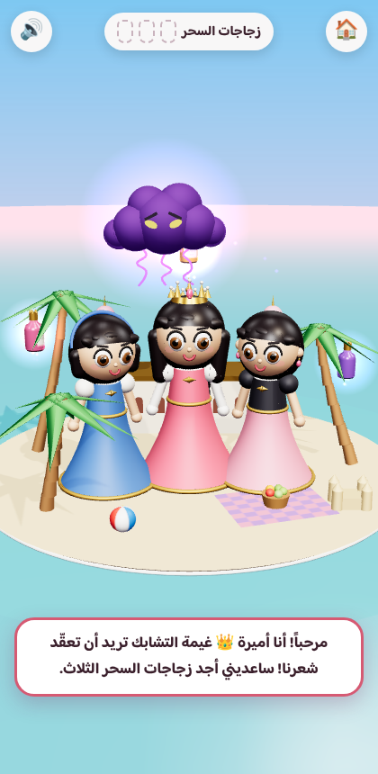
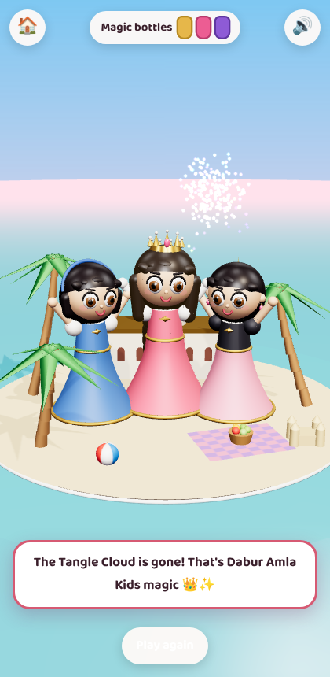

# Princess Amira AR World 👑

A browser-based augmented-reality world for **Princess Amira** from the Dabur Amla Kids cartoon series. There's no app to install: the child opens a link, places Amira's palace-beach island on a table or the floor, and helps her collect three magic bottles. The bottles grow her long, strong hair, and her hair magic chases away the Tangle Cloud.

 

See [`docs/CHARACTER_BIBLE.md`](docs/CHARACTER_BIBLE.md) for who Amira is, her look, and the AR story.

## Features
- **WebXR AR** (`immersive-ar` + hit-testing): find a surface, tap to place the island, then tap things in the scene to interact.
- **Size switch** in AR: Tabletop, Big, or **Life-size** (Amira is about 1 m tall, so kids can stand next to her).
- **3D mode** fallback for iPhone, desktop and anything else without WebXR AR. You can orbit, zoom and tap.
- **Mini-game:** collect 3 bottles (gold, pink, purple). Amira's hair grows and shines after each one, then she casts hair magic and the cloud is defeated, followed by a celebration.
- **Interactions:** Amira twirls, waves and talks; her friends cheer; the cloud taunts; the beach ball bounces.
- **Arabic-first, bilingual** (AR/EN, RTL aware). Sparkles and sounds are generated in the browser, so there are **no asset files**.

## Run locally
```bash
python3 -m http.server 8080
# open http://localhost:8080
```
WebXR AR needs **HTTPS** (or `localhost`). To test on a phone, deploy to any static HTTPS host (GitHub Pages, Netlify, Vercel) or use a tunnel such as `npx localtunnel --port 8080`, then open the link in **Chrome on an ARCore-supported Android phone**.

Add `?debug` to the URL to expose `window.amiraDebug` for automated screenshots.

## Device support
| Device | Experience |
|---|---|
| Android + Chrome (ARCore) | Full AR |
| iPhone / iPad (Safari) | 3D mode. iOS Safari doesn't support WebXR AR yet; see the roadmap. |
| Desktop | 3D mode |

## Code map
| File | What it does |
|---|---|
| `index.html`, `styles.css` | Start screen, HUD, speech bubble (also the WebXR DOM overlay) |
| `src/main.js` | Renderer, AR session and hit-test, 3D mode, tap picking, game flow |
| `src/amira.js` | Procedural 3D Amira and friends: blink, sway, wave, twirl, cheer, cast, hair growth |
| `src/world.js` | Island, palace, palms, picnic, bottles, Tangle Cloud |
| `src/effects.js` | Sparkle particles and synthesized sounds |
| `src/i18n.js` | All Arabic and English copy |

## Roadmap / next steps
1. **Use the studio's real Amira model.** Export the series rig as a `.glb` (with idle, wave, twirl and cheer clips) and load it with `GLTFLoader` in place of `buildAmira()`. The API in `amira.js` is already shaped for this.
2. **iOS AR:** ship a USDZ of the island for AR Quick Look, or use a WebAR SDK (8th Wall / Zappar) for full iOS parity.
3. **Voice lines** recorded by Amira's voice actor in place of the text bubbles.
4. **Photo mode** in Life-size, with a branded frame for social sharing.
5. More episodes as new "islands": the night battle scene, the palace, the market.
