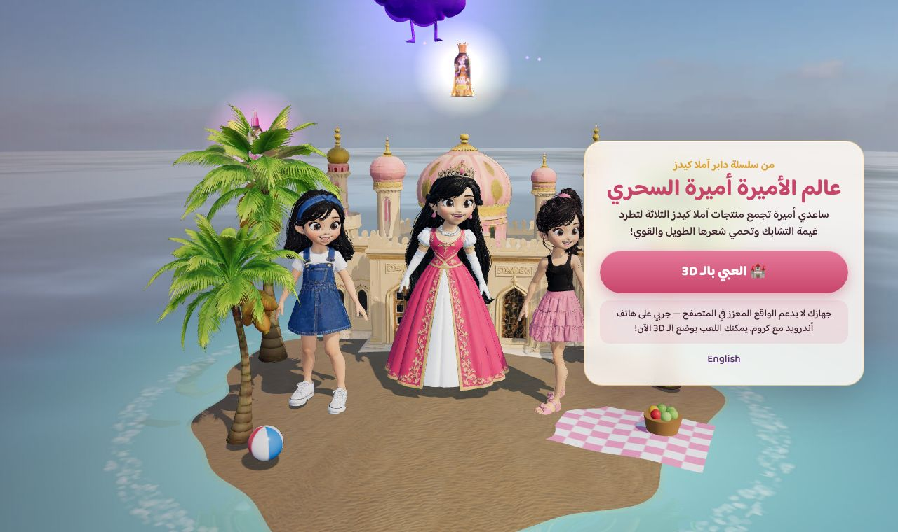
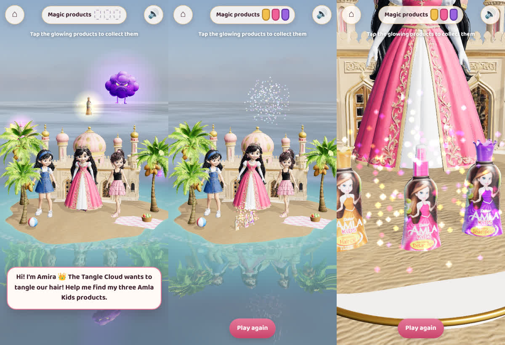

# Princess Amira AR World 👑

A browser-based augmented-reality world for **Princess Amira** from the Dabur Amla Kids cartoon series. There's no app to install: a child opens a link, places Amira's palace-beach island on a table or the floor, and helps her find her three **Dabur Amla Kids** products (Nourishing Hair Oil, Detangler, Shampoo). Then her hair magic chases away the Tangle Cloud, and the products rise on a plinth for the finale.




See [`docs/CHARACTER_BIBLE.md`](docs/CHARACTER_BIBLE.md) for who Amira is and the AR story.

## Amira Magic Scan (AR filter): `/scan/`
**https://daburdubaimktg-max.github.io/princess-amira/scan/** works on iPhone and Android, with no app.
Point the camera at the front of a pack, or at the printable [Amira card](scan/targets/amira_card.jpg).
It plays out as a short animated story, in Arabic or English:

1. **Opening.** Letterbox bars slide in, music swells, and a golden portal opens in the room.
   A title card reads *Dabur Amla Kids presents: Amira and the Tangle Storm*.
2. **The kingdom rises.** A floating island with a palace, palms and a waterfall rises through the
   portal, centred in front of you. Light rays fall and Amira arrives on a beam of light and
   says hello in her own voice.
3. **Chapter 1, Golden Magic:** catch the pack's magic items as they swoop around in 3D: amla berries
   (Hair Oil), bubbles (Detangler, Shampoo) or stars (card). A rare golden star is worth 50.
4. **Chapter 2, The Tangle Storm:** the sky darkens, rain and lightning roll in, and grumpy tangle knots
   fly at Amira's hair. Pop them before they reach her, or she loses a heart ❤️.
5. **Chapter 3, The Tangle Cloud:** a boss. Tap it to shrink it; it spits knots back. At zero,
   Amira casts her magic and it bursts.
6. **Finale, The Royal Celebration:** the sun breaks through, a rainbow arcs over the island, fireworks go off, Amira
   dances, and the pack rises on a glowing pedestal under a spotlight.

The world is pinned in the room with the phone's gyroscope once the pack is found, so you can look
around it. The score is synthesized live in the browser (`scan/music.js`). Amira's voice lines are in
`assets/voice/`.

There are combos (up to x5), floating scores, a star rating from the hearts left, and the pack's line on
the win card. Tap Amira to tickle her, **💃 Dance**, and **📸 Photo with Amira**.

**How Amira is made:** she's the series' own cartoon render, not a 3D model (automatic 3D
conversion of a cartoon face looks uncanny). Four short clips (wave, dance, cheer, magic) were
generated from that render on a green screen (`assets/amira/*.mp4`). The filter keys out the green
live and stands her in the 3D scene, always facing the camera. Every clip starts and ends on her
still pose (`assets/amira/still.jpg`), so they chain seamlessly.

- The three packs share the same artwork, so the tracker finds "a pack" and the filter then reads
  the label colour (gold, pink or purple) to tell which one it is.
- Image tracking is [MindAR](https://github.com/hiukim/mind-ar-js), in the browser. Targets are in
  `scan/targets/targets.mind`; rebuild them with `tools/compile_targets.html`.

## What's in the world
| Asset | How it was made |
|---|---|
| **Amira** (rigged, animated: idle, wave, cheer, spell-cast) | Frames from the series → clean turnaround ([`docs/reference/amira_turnaround.jpg`](docs/reference/amira_turnaround.jpg)) → Meshy 7 image-to-3D (textured, PBR, auto-rig). Only her arm bones are animated; hops, twirls and dancing move her whole body, so her neck and gown never distort. |
| **Two friends** (blue headband, ponytail) | Same pipeline from the beach-episode frame |
| **Palace, palm trees, Tangle Cloud** | Meshy text-to-3D, PBR |
| **Hair Oil, Detangler, Shampoo** | Built from the **official packshots**: the silhouette is traced into a 3D lathe and the packshot becomes the front label, so the logo and copy are pixel-exact (`tools/build_products.py`, `src/products.js`) |
| Sky / lighting | Poly Haven *Kloofendal 43d Clear* sky (CC0) as environment light |
| Sand, sea | Poly Haven photoscanned sand (CC0), three.js reflective `Water` |

All models are compressed for phones (quantized geometry, WebP textures): about 26MB in total.

## Features
- **WebXR AR** (`immersive-ar` + hit-testing): find a surface, tap to place, tap to play. Shadows land on the real table.
- **Sizes:** Tabletop, Big, or **Life-size** (Amira is about 1m tall).
- **3D mode** for iPhone and desktop: orbit, zoom, tap.
- **Arabic-first, bilingual** (AR/EN, RTL aware). Sparkles and sounds are generated in the browser.

## Run locally
```bash
python3 -m http.server 8080   # open http://localhost:8080
```
WebXR AR needs **HTTPS**. The repo deploys itself to GitHub Pages (`.github/workflows/pages.yml`) on every push to `main`:

1. **Settings → Pages → Build and deployment → Source: GitHub Actions** (one time).
2. Merge to `main` (or run the workflow from the Actions tab).
3. Open **https://daburdubaimktg-max.github.io/princess-amira/** in **Chrome on an ARCore Android phone** and tap *Start AR*.

Pages on a private repo needs a paid GitHub plan, and the published site is public (anyone with the URL can open it). Add `?debug` to expose `window.amiraDebug` for automated screenshots.

## Asset pipeline (`tools/`)
| Script | Purpose |
|---|---|
| `build_products.py oil=… detangler=… shampoo=…` | Packshot (white background) → label atlas + silhouette profile |
| `optimize.sh in.glb out.glb [size]` | Compress a generated GLB for the web |
| `animonly.mjs rigged.glb out.glb` | Keep only the skeleton + clip from an extra animation export |
| `tojson.mjs in.glb outDir` | Republish a GLB as glTF JSON (used for hosts that don't serve `.glb`) |

## Code map
| File | What it does |
|---|---|
| `index.html`, `styles.css` | Start card, loading bar, HUD, speech bubble (also the WebXR DOM overlay) |
| `src/main.js` | Renderer, sky lighting, AR session + hit-test, 3D mode, game flow, finale |
| `src/world.js` | Loads and places every asset; island, sea, characters + animation mixer |
| `src/products.js` | Real product bottles from packshot profiles |
| `src/effects.js` | Sparkle particles and synthesized sounds |
| `src/i18n.js` | All Arabic and English copy |

## Next steps
1. **Swap in the studio's own Amira rig** if one exists. The generated model is close to on-model, but the series' master asset will always win. Drop it in as `assets/models/amira.glb`.
2. **Real back-label art** for the three packs: the backs are currently plain bottle colour.
3. **iOS AR** via a USDZ export of the island (AR Quick Look) or a WebAR SDK.
4. **Voice lines** recorded by Amira's voice actor.
